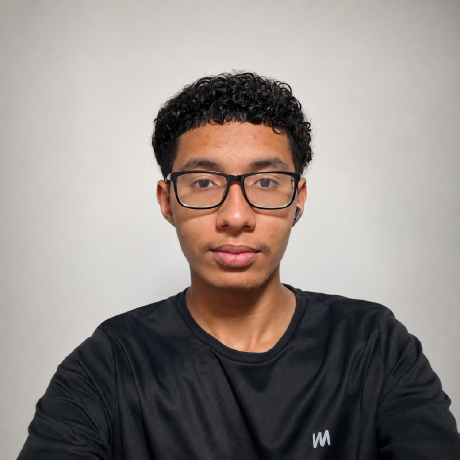
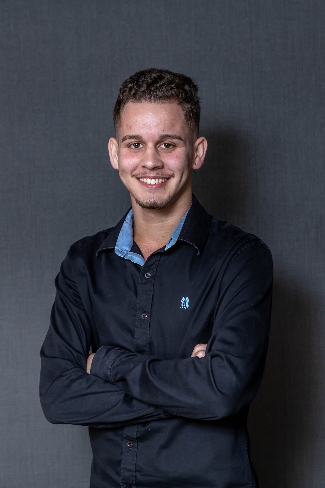
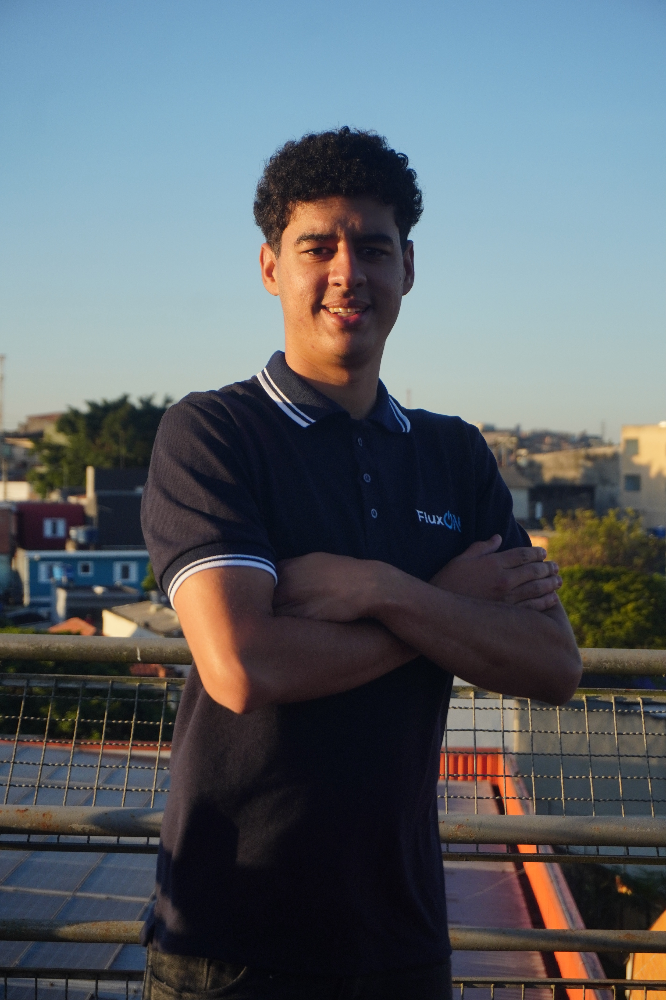
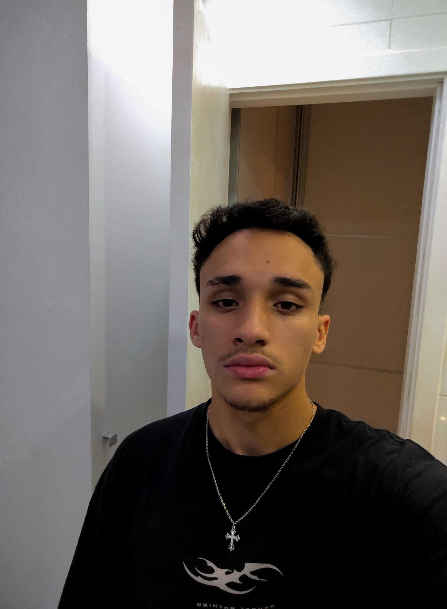
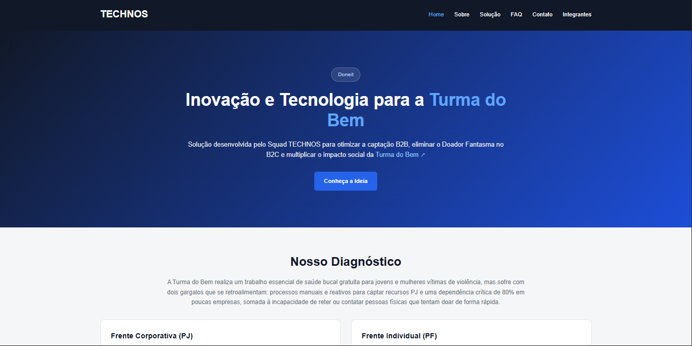
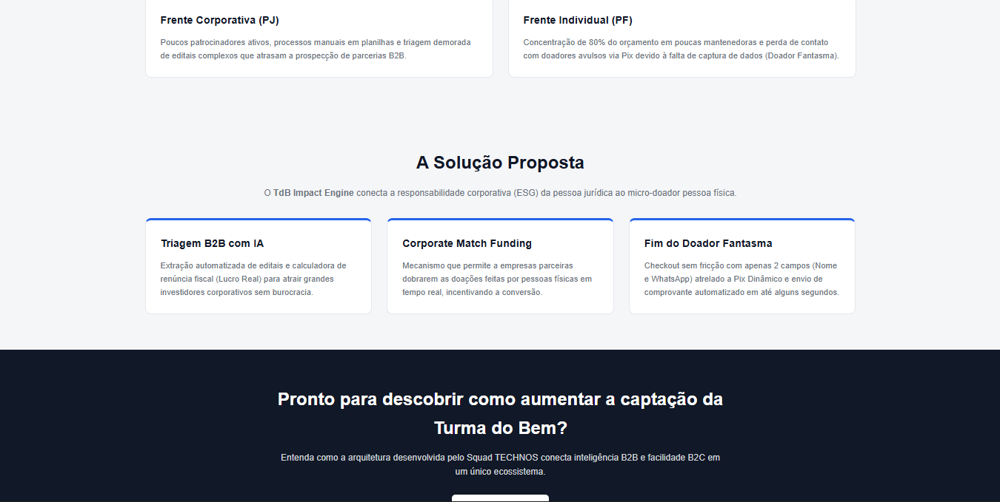
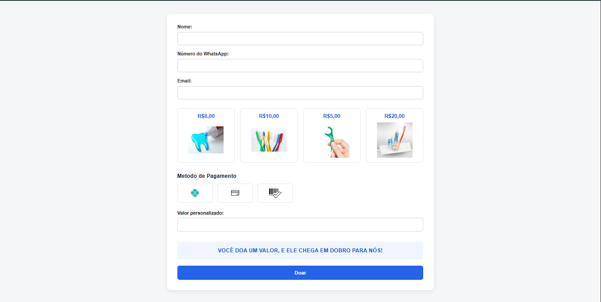
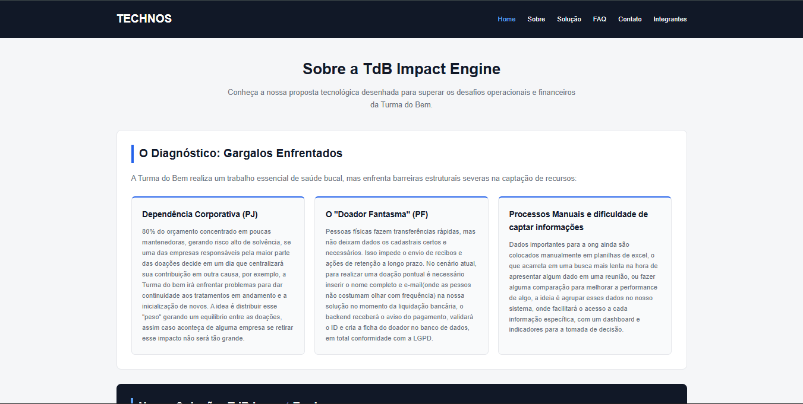
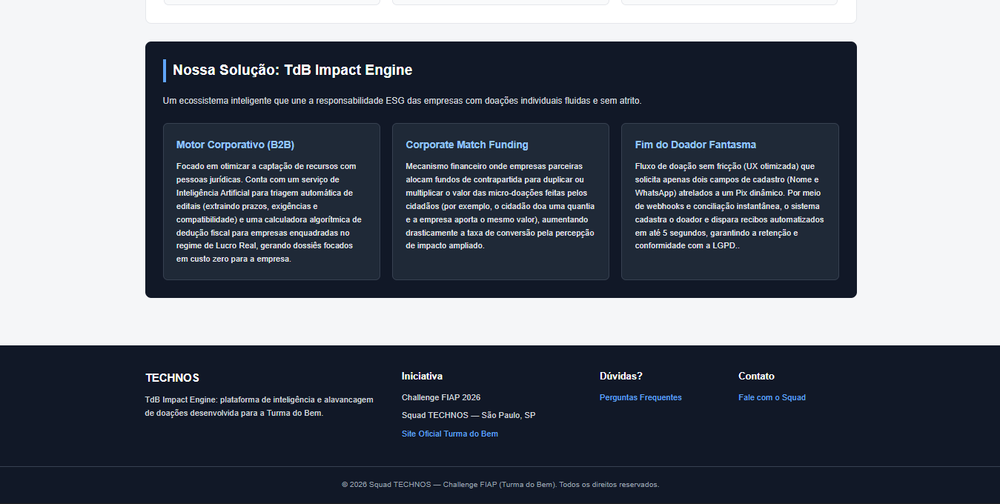

# TECHNOS — Doneit

**Challenge FIAP 2026 | Turma do Bem**

## 1. Sobre o projeto

A nossa solução é uma plataforma desenvolvida pela equipe TECHNOS com o objetivo de apoiar a Turma do Bem na gestão e no incentivo às doações.

A proposta busca facilitar a jornada dos doadores, melhorar a organização das informações e contribuir para uma gestão mais eficiente das contribuições recebidas.

Por meio de uma interface intuitiva, o projeto apresenta recursos voltados à divulgação da iniciativa, à apresentação dos itens de doação e ao incentivo à participação de pessoas e empresas.

### Objetivos do projeto

- Facilitar o processo de doação.
- Incentivar a participação de novos doadores.
- Melhorar a experiência dos usuários na plataforma.
- Contribuir para a organização e a gestão das doações.
- Apoiar o trabalho social realizado pela Turma do Bem.

## 2. Status da Sprint 2

**Status:** concluída

Na Sprint 2, o site estático da Sprint 1 evoluiu para uma interface responsiva e interativa, mantendo a estrutura de páginas e a identidade visual.

### Funcionalidades implementadas

- **Layout responsivo:** adaptação para mobile (até 480px), tablet (a partir de 768px) e desktop (a partir de 992px e 1300px) com `@media queries`.
- **Menu hambúrguer:** em telas menores, o menu abre e fecha pelo botão; fecha também ao clicar em um link, ao apertar `Esc` ou ao voltar para o tamanho desktop.
- **Calculadora de doação:** na página de doação, o total é atualizado automaticamente conforme o usuário marca os itens ou digita um valor personalizado.
- **Unidades relativas:** medidas do CSS convertidas de `px` para `rem`.

## 3. Tecnologias utilizadas

As tecnologias utilizadas no desenvolvimento do projeto incluem:

- **HTML5:** estruturação das páginas.
- **CSS3:** estilização, layout e responsividade.
- **JavaScript:** interatividade e manipulação de elementos.
- **Git:** controle de versão do código.
- **GitHub:** armazenamento e compartilhamento do repositório.

## 4. Estrutura de pastas

```text
front-end-challenge/
│
├── index.html
├── README.md
│
├── css/
│   ├── style.css
│   ├── nav.css
│   ├── responsivo.css
│   ├── sobre.css
│   ├── faq.css
│   ├── contato.css
│   ├── integrantes.css
│   ├── doar.css
│   ├── doadores.css
│   ├── edital.css
│   └── empresas.css
│
├── images/
│   ├── formas-pagamento/
│   ├── integrantes/
│   ├── itensdoacao/
│   ├── projeto/
│   └── logos e ícones
│
├── js/
│   └── main.js
│
└── paginas/
    ├── sobre.html
    ├── faq.html
    ├── contato.html
    ├── integrantes.html
    │
    └── solucao/
        ├── doar.html
        ├── doadores.html
        ├── edital.html
        └── empresas.html
```

## 5. Autores e integrantes

Equipe **Doneit — FIAP Challenge 2026**.

### Gustavo Souza Lopes

- **RM:** 575057
- **Turma:** 1TDSPT
- **LinkedIn:** [linkedin.com/in/gustavo-souza-lopes](https://www.linkedin.com/in/gustavo-souza-lopes)
- **GitHub:** [github.com/GustaLopess](https://github.com/GustaLopess)



### Kaique Ferreira Castro

- **RM:** 575222
- **Turma:** 1TDSPT
- **LinkedIn:** [linkedin.com/in/kaiquefcastro](https://www.linkedin.com/in/kaiquefcastro)
- **GitHub:** [github.com/kaiqueznx7](https://github.com/kaiqueznx7)



### Lucas Alves Pires

- **RM:** 576621
- **Turma:** 1TDSPT
- **LinkedIn:** [linkedin.com/in/lucaspires31](https://www.linkedin.com/in/lucaspires31)
- **GitHub:** [github.com/lucaspires31](https://github.com/lucaspires31)



### Rafael Girardi Ramos

- **RM:** 575391
- **Turma:** 1TDSPT
- **LinkedIn:** [linkedin.com/in/rafael-ramos-99a3b343b](https://www.linkedin.com/in/rafael-ramos-99a3b343b)
- **GitHub:** [github.com/Rafaelreifsss](https://github.com/Rafaelreifsss)


### Daniel Platero de Souza

- **RM:** 575084
- **Turma:** 1TDSPT
- **LinkedIn:** [linkedin.com/in/daniel-rodrigues-406927414](https://www.linkedin.com/in/daniel-rodrigues-406927414)
- **GitHub:** [github.com/Platero1310](https://github.com/Platero1310)



## 6. Imagens e demonstração

Capturas de tela das principais páginas para demonstrar o funcionamento e a identidade visual do sistema.

### Página inicial




### Página de doação



### Página sobre o projeto




## 7. Links do projeto

- **Site publicado (GitHub Pages):** [technosdevelopers.github.io/front-end-challenge](https://technosdevelopers.github.io/front-end-challenge/)
- **Repositório no GitHub:** [github.com/TechnosDevelopers/front-end-challenge](https://github.com/TechnosDevelopers/front-end-challenge)

## 8. Contato

Para dúvidas, sugestões ou informações sobre o projeto, entre em contato com os integrantes da equipe pelos respectivos perfis do LinkedIn ou GitHub listados na seção 5.

**Equipe:** TECHNOS  
**Projeto:** Doneit  
**Instituição:** FIAP  
**Desafio:** Challenge 2026 — Turma do Bem

---

Desenvolvido pela equipe TECHNOS como parte do Challenge FIAP 2026.
